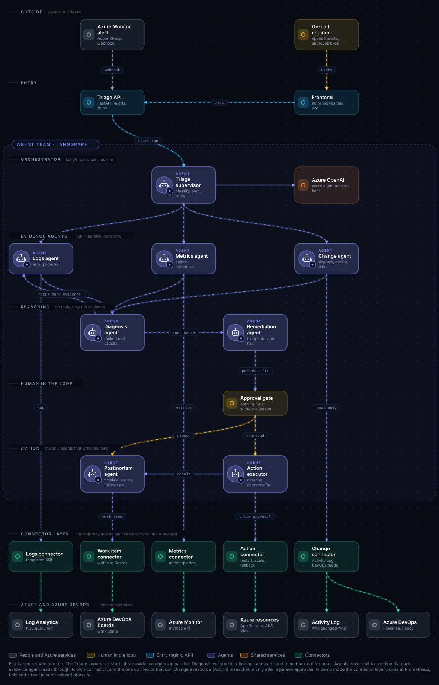

# Incident Triage Agents for Azure: Blueprint

> Status: DRAFT v0.2. Business logic and architecture are agreed in outline. The architecture page runs in Docker (`docker compose up -d --build`, then http://localhost:8080). Backend is not started.

## 1. Terminology

- **Agentic application**: software where an LLM decides what to do next (call tools, delegate, loop) instead of following a fixed script. We are not building a "model". We build the system around an existing LLM.
- **Agent**: an LLM + a role prompt + a set of tools.
- **Multi-agent system**: several specialised agents coordinated by an orchestrator.

## 2. Decisions so far

| Question | Decision |
|---|---|
| Use case | **Incident Triage (DevOps)**. Stock analysis was considered and dropped (hard to test, rate-limited free data, weaker engineering story). It could be a small second project later. |
| Cloud focus | **Azure**, starting with **Azure Monitor**, then **demo mode**. |
| Azure DevOps | Included: read deploys and commits, write the postmortem work item. |
| Autonomy | Diagnose and recommend. Fixes run only after **human approval**. |
| Still open | Framework (LangGraph proposed), LLM provider (Azure OpenAI proposed), hosting (Azure Container Apps proposed), final agent roster. |

## 3. Architecture

### Diagram

Interactive version: the `frontend/` app (hover a box to follow its links). This image is generated from the same data, so the two stay in sync: run `npm run export:diagram` in `frontend/` after changing `diagrams.ts`.

### Reading the diagram

- **How to spot the agents:** each one has a robot avatar and an AGENT tag, and the dashed "Agent team" zone wraps everything the LangGraph orchestrator runs. The approval gate and Azure OpenAI sit inside the zone but are not agents.
- **Eight agents share one run.** The Triage supervisor starts three evidence agents in parallel. Diagnosis weighs their findings. Remediation proposes a fix. Executor and Postmortem act on the result.
- Agents never call Azure directly. Each evidence agent reads through its own connector (Logs, Metrics, Change).
- The one connector that can change a resource (Action) is reachable only after the approval gate.
- The Diagnosis agent can send the evidence agents back out, so a weak first guess costs another round of queries, not a wrong answer. Cap the number of rounds.
- The Postmortem agent always runs, whether or not a fix was approved, and files its report through the Work item connector.
- Every agent reasons through Azure OpenAI. Run state and traces (Postgres, Langfuse) are planned but not drawn.

### Agent roster

| Agent | Job | Tools it may use | Can change anything? |
|---|---|---|---|
| Triage supervisor | Read the alert, pick affected resources, decide which evidence agents to start | none | No |
| Logs agent | Find error patterns in the alert window | Logs connector (templated KQL, Log Analytics) | No |
| Metrics agent | Find spikes and saturation | Metrics connector (Azure Monitor metrics) | No |
| Change agent | Find recent deploys, commits and config changes | Change connector (Activity Log, Azure DevOps Pipelines and Repos) | No |
| Diagnosis agent | Rank root causes with cited evidence, request more evidence if confidence is low | none | No |
| Remediation agent | Propose fixes with risk and a rollback plan | none | No |
| Action executor | Run the approved fix | Action connector (Azure Resource Manager) | Yes, only after approval |
| Postmortem agent | Write timeline, cause and follow-ups | Work item connector (Azure DevOps Boards) | Creates a work item |

### How one incident moves through the system

1. **Alert fires.** Azure Monitor posts the alert to `/alerts`. The API stores a run and starts the graph.
2. **Triage.** The supervisor reads the alert, picks the affected resources and decides which evidence agents to start.
3. **Evidence, in parallel.** Logs, Metrics and Change agents query only through connectors and return findings with confidence.
4. **Diagnosis.** Ranks root causes and cites the evidence. Low confidence loops back for more queries.
5. **Remediation and approval.** Fix options are scored for risk. A person approves in the web UI before anything executes.
6. **Execute and write up.** The executor runs the approved fix. The postmortem agent files the report to Azure DevOps Boards.

## 4. Connecting to Azure and Azure DevOps

The agents call **tools**, and each tool is a thin adapter over an Azure API. Tools can be plain Python functions or MCP servers, so any MCP-capable client can reuse them. Azure DevOps has an official MCP server and Microsoft publishes an Azure MCP server. Check whether reusing them saves code.

| Need | Azure source | Access method |
|---|---|---|
| Alerts coming in | Azure Monitor alert rules, with an Action Group webhook pointing at the API | Webhook (push) |
| Logs | Log Analytics workspace (KQL) | `azure-monitor-query` SDK |
| Metrics | Azure Monitor metrics (CPU, latency, HTTP 5xx) | Same SDK |
| Resource state and changes | Azure Resource Graph, Activity Log | `azure-mgmt-*` SDKs |
| Recent deploys and code changes | Azure DevOps Pipelines and Repos (or GitHub) | Azure DevOps REST API or MCP |
| Work items and notifications | Azure DevOps Boards, Teams or Slack | REST API |
| Fixes (restart, scale, rollback) | Azure Resource Manager, pipeline re-run | SDK, only after human approval |

### Authentication

- **Diagnosis (read-only)**: a **service principal** or **managed identity** with `Monitoring Reader`, `Log Analytics Reader` and `Reader`. Safe by default.
- **Fix actions**: a separate, narrowly scoped role (for example restart one specific App Service). Off by default.
- **Azure DevOps**: a Personal Access Token or an Entra ID app with read scope on Pipelines, Repos and Boards.
- **Secrets**: Key Vault or environment variables. Never in the repo.
- The user keeps their data. Their credentials stay on their side and the agents query their workspace.

### Making it reusable by other people

1. **Config-driven setup**: a `config.yaml` holds subscription ID, workspace ID, resource groups, DevOps org and project. Nothing hardcoded.
2. **Pluggable connectors**: agents call an interface such as `get_logs(resource, time_range)`. One implementation uses Azure, another uses Prometheus and Loki (demo). Adding AWS or Datadog later means a new connector, not new agents.
3. **Two modes**
   - **Demo mode**: simulated app plus fault injector. No Azure account needed.
   - **Live mode**: points at a real Azure subscription.
4. **Read-only by default**, with approval gates for anything that changes a resource.

### Limitations to state honestly

- A real Azure subscription costs money (Log Analytics ingestion, a demo app). Set budget alerts.
- LLM-written KQL is error-prone. Use templated queries for common cases and let the agent fill in parameters. Free-form KQL is a fallback.
- Logs are sent to the LLM. Say plainly in the README what leaves the user's environment.
- "Anyone can use it" means anyone willing to set up the service principal and webhook. Fine for open source, not a one-click product.

## 5. Build order

1. **Azure Monitor first**: alert webhook, Log Analytics and metrics connectors, Activity Log.
2. **Demo mode**: simulated app, Prometheus and Loki connectors, fault injector, scored scenarios.
3. **Azure DevOps** connectors (Change reads, Work item writes) once the core agents work.

Done so far: the architecture page (`frontend/`, Docker Compose, port 8080), including a **Play a run** replay on the Overview. It plays a scripted incident (bad deploy, memory leak or database connections) through the diagram, pauses at the approval gate for Approve or Reject, and writes an event log. The steps live in `frontend/src/features/architecture/scenarios.ts` and have the shape of the events the real backend should stream, so real runs can replace the script later.

## 6. Open questions

1. Is the agent roster right? Options: merge Logs and Metrics into one agent, or add a Critic that checks the diagnosis before remediation.
2. Framework: LangGraph, Microsoft Agent Framework, CrewAI, or plain Python?
3. LLM provider: Azure OpenAI or the Anthropic API?
4. Hosting: Azure Container Apps, AKS, or App Service?
5. Approvals in the first version are web UI only (Teams later). Confirm.
6. Backend layout (repo structure, phases, deployment): to be discussed next.
