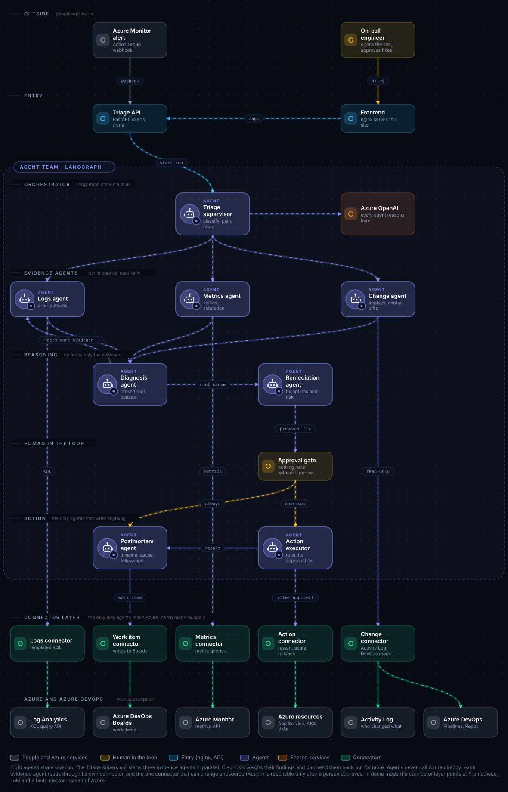

# Incident Triage Agents for Azure

A team of eight AI agents that triages an Azure incident. An Azure Monitor alert wakes a Triage supervisor, three evidence agents (Logs, Metrics, Change) query in parallel, a Diagnosis agent names the likely root cause, a Remediation agent proposes a fix, and a person approves before anything runs. A Postmortem agent files the report to Azure DevOps Boards either way.



## Status

Early. The agent graph runs end to end in demo mode, against built-in incident data and a scripted stand-in for the LLM. Azure connectors and a real LLM are next. See [BLUEPRINT.md](BLUEPRINT.md) for the design, the agent roster and the build order.

| Part | State |
|---|---|
| Architecture page with **Play a run**: a simulated replay, or a live run on the backend (`frontend/`) | Running in Docker |
| LangGraph agent graph, approval pause, event stream, API (`backend/`) | Running in Docker, demo mode, 25 tests |
| Connector interfaces | Defined, demo implementations only |
| Azure connectors, Azure OpenAI reasoner, demo environment with a fault injector | Planned |

## Run it

Needs Docker.

```bash
docker compose up -d --build
```

- http://localhost:8080 is the site. Press **Play a run** for a simulated replay, or switch to **Live backend** and press **Start live run** to watch the real agent graph run on the server. Approve or reject at the gate in either mode.
- http://localhost:8010/docs is the API. Start a real run (demo data) and watch it:

```bash
curl -X POST localhost:8010/runs -H 'content-type: application/json' \
  -d '{"title":"orders-api latency","resource":"orders-api","labels":{"demo_scenario":"bad-deploy"}}'
curl -N localhost:8010/runs/<id>/events                 # server-sent events
curl -X POST localhost:8010/runs/<id>/approval -H 'content-type: application/json' -d '{"decision":"approve"}'
```

Demo scenarios: `bad-deploy`, `memory-leak`, `db-connections`. The run pauses at the approval gate until you approve or reject.

Stop it with `docker compose down`.

## Test the backend

```bash
docker run --rm -v "$PWD":/repo -w /repo/backend python:3.12-slim \
  sh -c "pip install -q -e '.[dev]' && python -m pytest -q"
```

The tests check each scenario and the loop back for more evidence, that the three evidence agents truly run in parallel, that a reject changes nothing, and that every node and link the backend emits exists in the frontend diagram.

## Develop the frontend

Needs Node 22.

```bash
cd frontend
npm install
npm run dev            # http://localhost:5173
npm run export:diagram # regenerate docs/architecture.svg from the diagram data
```

The diagram is defined in `frontend/src/features/architecture/diagrams.ts`, and the replay scripts are in `scenarios.ts` in the same folder.
