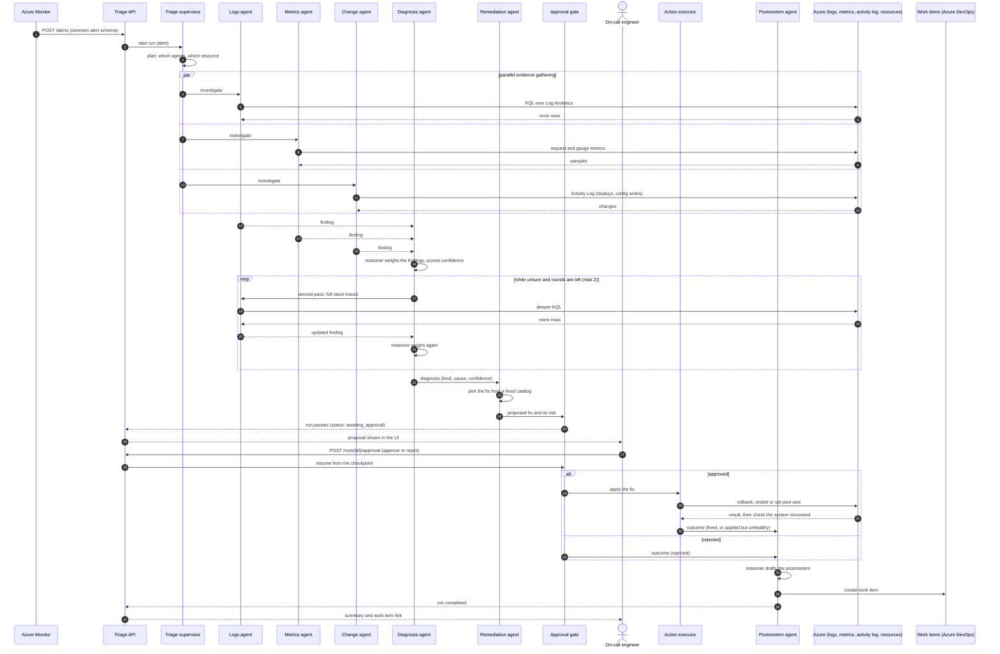

# One incident, step by step

What happens from the alert to the closed run. GitHub renders the diagram below.
The code behind each step is in `backend/src/triage/` (`graph.py` wires the steps, `agents.py` holds them).

## Notes

- The Logs, Metrics and Change agents run at the same time. Diagnosis starts only when all three have reported.
- The loop is capped (`Deps.max_rounds`, default 2), so Diagnosis cannot ask forever.
- The pause at the approval gate is a LangGraph `interrupt`. The run's thread ends, and approving starts a new
  thread that resumes from the checkpoint. Nothing in the executor can run before a person decides.
- The Postmortem agent always runs, whether the fix worked, failed, was rejected or was not applicable.
- In Azure mode the Action executor is not wired yet, so an approved fix is reported as "not applied" and handed to a person.
- The work item sink is in-memory today (`DemoWorkItems`). The Azure DevOps connector is planned.
